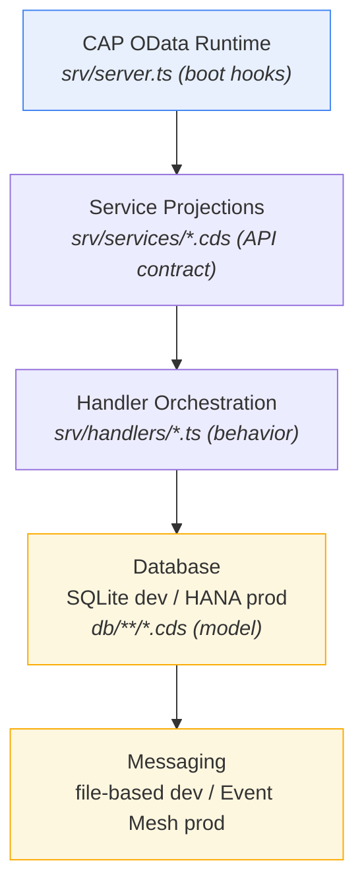
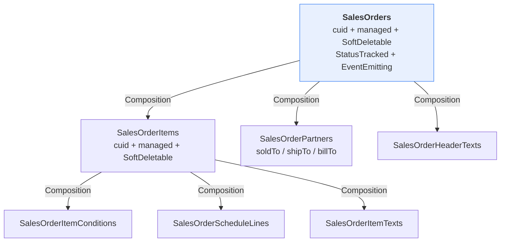
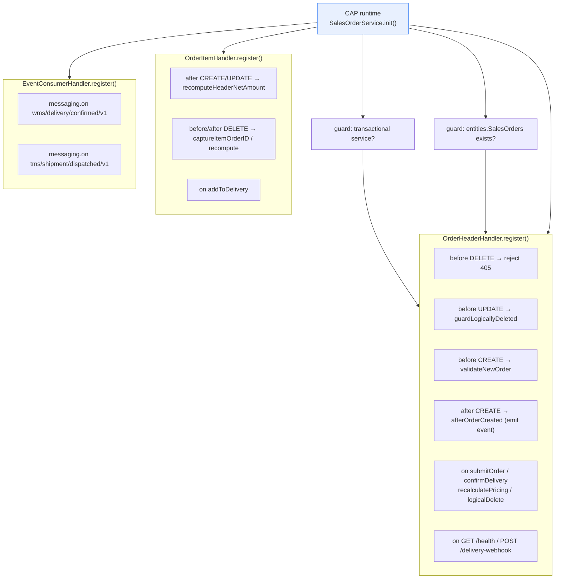

# DEBUG-Driven Learning Roadmap
## SAP CAP Sales Order — TypeScript Reference Project

**Audience:** developers joining this project who want to understand the full system by running and debugging it, not just by reading it.  
**Approach:** follow the same path a request travels through the system — from configuration to data model to service contract to handler logic to UI to integration — setting breakpoints at each boundary.  
**Prerequisites:** Node ≥ 20, VS Code with SAP CDS Language Support extension, project dependencies installed (`npm install`).

> **Shell note:** `cds` is a local dev-dependency, not a global CLI. Always use `npm run dev` instead of `cds watch` in this project.

---

## Orientation: How the Project Is Layered



Each step in this roadmap drills one layer deeper.

---

## Step 1 — Project Structure Overview

### Objective
Build a mental map of the repository before touching any code.

### Files to Analyze

| Path | Role |
|------|------|
| [db/index.cds](../db/index.cds) | Persistence model entry point |
| [srv/index.cds](../srv/index.cds) | Service model entry point |
| [app/services.cds](../app/services.cds) | Fiori annotation consumer entry point |
| [docs/ARCHITECTURE.md](./ARCHITECTURE.md) | Architecture decisions (ADRs) |
| [package.json](../package.json) | Project scripts and CAP configuration |

### What to Inspect
Open `db/index.cds` and trace each `using from` import:
- `domain/sales-orders` → aggregate root and children
- `masterdata/master-data` → supporting sub-domain entities
- `aspects/domain-aspects` → reusable field mixins
- `types/common-types` → primitive aliases and enums

Repeat for `srv/index.cds`: notice it aggregates service CDS definitions **and** CDS annotation files.

### Key Concepts
- CAP auto-discovery: the framework reads all `.cds` files in `db/` and `srv/` automatically; `index.cds` files are the explicit re-export points.
- Separation of concerns: `db/` is the persistent schema, `srv/services/` is the API contract, `srv/handlers/` is behavior, `app/` is the UI consumer.
- The compiler never sees raw entities in `app/` — only service projections.

### Debugging Strategy
No breakpoint yet. Draw a dependency graph on paper:
```
db/index.cds
  └─ domain/sales-orders.cds     → SalesOrders aggregate
  └─ masterdata/master-data.cds  → Products, BusinessPartners
  └─ aspects/domain-aspects.cds  → SoftDeletable, StatusTracked
  └─ types/common-types.cds      → SalesOrderNumber, UoM…

srv/index.cds
  └─ services/sales-order-service.cds   → 4 OData services
  └─ services/integration-service.cds  → IntegrationService
  └─ services/annotations.ui.cds       → Fiori UI metadata
  └─ services/annotations.analytics.cds → ALP metadata
```

### Expected Outcome
You can explain where the domain starts, where services start, and why the same entity appears in multiple places under different names (domain entity vs service projection vs flat view).

---

## Step 2 — Configuration Files and Environment Setup

### Objective
Understand how the project boots, how environments differ, and what runtime dependencies CAP resolves.

### Files to Analyze

| Path | What to focus on |
|------|-----------------|
| [package.json](../package.json) | `scripts`, `cds.requires`, `cds.typescript` |
| [srv/server.ts](../srv/server.ts) | Custom startup hooks |
| [tsconfig.json](../tsconfig.json) | TypeScript compilation settings |
| [xs-security.json](../xs-security.json) | XSUAA role templates |
| [mta.yaml](../mta.yaml) | BTP deployment modules |

### What to Inspect

In `package.json`, read the `cds` block with these questions:
1. Which `db.kind` is active in development vs production?
2. Which `auth.kind` is active — and who are the mocked users and their roles?
3. Which messaging kind is active — and what changes in production?
4. What does `"typescript": true` enable?

In `srv/server.ts`, read the two event hooks: `cds.on('listening')` and `cds.on('READ')`. These fire at server startup and on every OData READ respectively.

### Key Concepts
- CAP profile blocks `[development]`, `[test]`, `[production]` resolve at runtime via `NODE_ENV`.
- Mocked users (alice, bob, charlie, dave) have pre-assigned roles that are checked against `@requires` and `@restrict` annotations in service definitions.
- `"typescript": true` tells the CAP Node.js runtime to resolve handler files as `.ts` directly via `tsx`, without a compile step in development.
- `@sap/cds-dk` is in `devDependencies` (CLI-only). It is never loaded in production.

### Suggested Breakpoints

```
srv/server.ts : Line 4  → cds.on('listening', ...)
srv/server.ts : Line 9  → cds.on('READ', ...)
```

When `npm run dev` starts, pause at line 4 and inspect the `url` parameter. Pause at line 9 on the first browser request and inspect `req.target.name` — this tells you which entity was read.

### Expected Outcome
You understand how the same project behaves differently in dev, test, and production without code changes, and you can explain which user can call which operation before looking at any handler code.

---

## Step 3 — Data Model Layer (CDS Domain Model)

### Objective
Learn the persistent domain model from the bottom up before looking at any service or handler.

### Files to Analyze (read in this order)

| Path | What it defines |
|------|----------------|
| [db/types/common-types.cds](../db/types/common-types.cds) | Primitive aliases, enums, roles |
| [db/aspects/domain-aspects.cds](../db/aspects/domain-aspects.cds) | `SoftDeletable`, `StatusTracked`, `EventEmitting` |
| [db/masterdata/master-data.cds](../db/masterdata/master-data.cds) | Products, BPs, SalesAreas, code lists |
| [db/domain/sales-orders.cds](../db/domain/sales-orders.cds) | `SalesOrders` aggregate root and all children |

### What to Inspect

In `domain/sales-orders.cds`, trace the ownership chain:



For each child, ask: is it `Composition` or `Association`? If `Composition`, its lifecycle is owned by the parent. If `Association`, it points to an independently-managed entity.

Pay attention to these architectural decisions:
- `SalesOrders.netAmount` is `@readonly @Core.Computed` — it cannot be PATCHed by clients.
- `overallStatus`, `deliveryStatus`, `billingStatus` are also `@readonly @Core.Computed`.
- `SalesOrderItems` carries `cuid` (its own UUID) because grandchildren reference it by a single UUID FK, not by a composite key. Without this, the CDS compiler cannot redirect associations through flat views.
- `SalesOrderPartners` mirrors the SAP VBPA pattern: one row per `(order, role)` pair instead of three separate FK columns.

### Key Concepts
- DDD aggregate root and composition boundary
- Surrogate UUID key (`cuid`) vs business key (`salesOrder` / `itemNumber`)
- Reusable aspects as field mixins
- `@assert.unique` for business key uniqueness enforced at the DB level
- `@ChangeTracking`, `@PersonalData` as plugin activation annotations

### Debugging Strategy
No runtime session yet. Read `ARCHITECTURE.md` sections ADR-01 through ADR-07 alongside the CDS file. Each ADR explains one modelling decision and its consequences. Cross-reference any field annotated `@readonly` or `@Core.Computed` with the handler that writes it (Step 5).

### Expected Outcome
You can explain the aggregate boundary, why items have their own UUID, what each aspect adds to an entity, and which fields are computed by handlers rather than set by clients.

---

## Step 4 — Service Layer: OData Contracts and Projection Strategy

### Objective
Understand how the domain model is exposed as APIs and why the project uses five services instead of one.

### Files to Analyze

| Path | Service(s) defined |
|------|-------------------|
| [srv/services/sales-order-service.cds](../srv/services/sales-order-service.cds) | `SalesOrderService`, `SalesOperationalService`, `SalesCatalogService`, `SalesAnalyticsService` |
| [srv/services/integration-service.cds](../srv/services/integration-service.cds) | `IntegrationService` |

### Service Mapping

| Service | Path | Consumer | Persona |
|---------|------|----------|---------|
| `SalesOrderService` | `/api/orders` | CPI inbound, external apps | SalesProcessor, SalesManager, SalesAuditor |
| `SalesOperationalService` | `/api/ops` | Fiori transactional app | Same roles |
| `SalesCatalogService` | `/api/catalog` | F4 helpers, Joule | CatalogReader |
| `SalesAnalyticsService` | `/api/analytics` | Fiori ALP, SAC | AnalyticsReader |
| `IntegrationService` | `/api/integration` | Admin / audit | SalesManager, SalesAuditor |

### What to Inspect

For `SalesOrderService`, locate:
1. `@cds.redirection.target: true` on `SalesOrders` — why is it needed when the same service also exposes `OpenOrders`?
2. `@odata.draft.enabled: true` — only on the root entity. What happens if you annotate a child?
3. `@restrict` blocks — read each `grant` verb and `where` clause. Map them back to the mocked users in `package.json`.
4. Bound actions declared inside `actions { }`: `submitOrder`, `confirmDelivery`, `recalculatePricing`, `logicalDelete`.

For `IntegrationService`, note the difference between `action` (modifies state) and `function` (read-only): `importFromNorthwind` is an `action`, `marshalOrderToOData` is a `function`.

### Key Concepts
- Projections decouple the API contract from the persistence schema
- `excluding { }` hides fields from OData clients without preventing handlers from writing them
- `@odata.draft.enabled` activates the entire CAP Draft mechanism on the Composition tree — annotating children creates duplicate shadow tables
- `@cds.redirection.target` resolves compiler ambiguity when two entity sets resolve to the same domain entity
- The same architectural rule that makes flat item views unsafe in `SalesOrderService` (see inline comments in the CDS file)

### Debugging Strategy
Open the browser at `http://localhost:4004` after `npm run dev`. Inspect:
- `http://localhost:4004/api/ops/$metadata` — the full OData service document
- `http://localhost:4004/api/analytics/$metadata` — notice it has `@Analytics.AggregatedProperty` entries that the transactional service does not

Map every `EntitySet` in the metadata back to its CDS projection definition.

### Expected Outcome
You can explain why each service exists, which user can access which operation, and why `SalesOrderItems` appears in the transactional service but flat item views appear only in the analytics service.

---

## Step 5 — Business Logic and Event Handlers

### Objective
Learn where business rules actually execute and how CAP wires handlers into the service lifecycle.

### Files to Analyze (in execution order)

| Path | Responsibility |
|------|---------------|
| [srv/handlers/sales-order-service.ts](../srv/handlers/sales-order-service.ts) | Orchestrator — `init()`, service guard, sub-handler composition |
| [srv/handlers/order-header-handler.ts](../srv/handlers/order-header-handler.ts) | DELETE guard, UPDATE guard, `submitOrder`, `confirmDelivery`, `recalculatePricing`, `logicalDelete` |
| [srv/handlers/order-item-handler.ts](../srv/handlers/order-item-handler.ts) | `netAmount` invariant, `addToDelivery` action |
| [srv/lib/validations.ts](../srv/lib/validations.ts) | Domain validation rules |
| [srv/lib/status-machine.ts](../srv/lib/status-machine.ts) | Legal status transitions |
| [srv/lib/events.ts](../srv/lib/events.ts) | Event publisher and type constants |


### Suggested Breakpoints

**Service bootstrap** (fires once per service per startup):
```
srv/handlers/sales-order-service.ts : Line 57  → await super.init()
srv/handlers/sales-order-service.ts : Line 59  → const serviceName = this.name
```
Inspect `this.name` and `this.entities`. Notice this handler is called multiple times — once per service that shares the same `.cds` file. The guard at line 65 is what prevents handlers from registering on `SalesCatalogService` or `SalesAnalyticsService`.

**Order creation** (fires on POST `/api/ops/SalesOrders`):
```
srv/handlers/order-header-handler.ts : Line ~100  → validateNewOrder
srv/handlers/order-header-handler.ts : Line ~113  → afterOrderCreated
```
Inspect `req.data` in `validateNewOrder` and `result` in `afterOrderCreated`.

**submitOrder action** (fires on POST `...SalesOrders(key)/SalesOperationalService.submitOrder`):
```
srv/handlers/order-header-handler.ts : Line ~131  → onSubmitOrder entry
srv/handlers/order-header-handler.ts : Line ~160  → SELECT ... forUpdate
```
Inspect `req.params[0]` for the entity key. On the `forUpdate` call, observe what SQL is emitted in the console output with `DEBUG=cds:sql npm run dev`.

**netAmount invariant** (fires after any item write):
```
srv/handlers/order-item-handler.ts : Line ~59   → recomputeHeaderNetAmountAfterItemChange
srv/handlers/order-item-handler.ts : Line ~145  → _syncHeaderNetAmount
```
After writing an item, step through `_syncHeaderNetAmount` and watch the `SUM` query and the header `UPDATE`.

### Key Concepts
- CAP hook phases: `before` (validate/guard) → `on` (custom replace default) → `after` (side effects)
- Registration order is FIFO within a phase; header handler registers before item handler
- `SELECT ... forUpdate({ wait: 5 })` emits `FOR UPDATE WAIT 5` on HANA; on SQLite it is accepted but has no locking effect
- The `before-DELETE captureItemOrderID` trick: after a row is deleted, CAP only passes its PK. The `order_ID` is read before deletion and stored on `req.data` so the `after-DELETE` handler can still compute the sum
- `this.name` is a plain `string` property defined on `cds.Service`; no cast is needed

### Expected Outcome
You can set a breakpoint on any hook, narrate why it fires at that phase, and explain what `req.params`, `req.data`, and the CQL result contain at that point.

---

## Step 6 — UI Annotations and Fiori Elements Behavior

### Objective
Connect service metadata to the actual screens rendered by Fiori Elements.

### Files to Analyze

| Path | What it controls |
|------|-----------------|
| [srv/services/annotations.ui.cds](../srv/services/annotations.ui.cds) | LineItem tables, SelectionFields, FieldGroups, Facets, action buttons for transactional apps |
| [srv/services/annotations.analytics.cds](../srv/services/annotations.analytics.cds) | ALP chart, PresentationVariants, SelectionVariants for analytics app |
| [app/salesorder-listview/webapp/manifest.json](../app/salesorder-listview/webapp/manifest.json) | Routing for List Report + Object Page chain |
| [app/salesorder-analytics-alp/webapp/manifest.json](../app/salesorder-analytics-alp/webapp/manifest.json) | Routing for Analytical List Page |
| [app/salesorder-listview/annotations.cds](../app/salesorder-listview/annotations.cds) | App-local annotation overrides |
| [app/salesorder-analytics-alp/annotations.cds](../app/salesorder-analytics-alp/annotations.cds) | App-local annotation overrides |

### How Annotations Drive UI

Fiori Elements is a metadata-driven renderer. There is no hand-written HTML or controller logic. Every column, filter, button, and facet is derived from OData `$metadata` enriched by annotation vocabulary terms.

Annotation → rendered element mapping:

| Annotation | UI element |
|-----------|-----------|
| `UI.LineItem` | Table columns in list report |
| `UI.SelectionFields` | Filter bar fields |
| `UI.HeaderInfo` | Object page header title and description |
| `UI.Facets` | Object page section tabs |
| `UI.FieldGroup` | Field group within a section |
| `UI.DataFieldForAction` | Action button in toolbar or identification area |
| `UI.Chart` | Chart in ALP |
| `UI.SelectionPresentationVariant` | Default view combining chart + table |

### Manifest Routing (transactional app)

```
manifest.json dataSources.mainService.uri = /api/ops/
  │
  routes:
    "" (default)             → SalesOrdersList   (ListReport, contextPath: /SalesOrders)
    SalesOrders({key})       → SalesOrdersObjectPage (ObjectPage)
    SalesOrders({key})/items({key2}) → SalesOrderItemsObjectPage (ObjectPage)
```

The analytics app routes its default to `OpenOrdersQuery` inside `SalesAnalyticsService`:
```
manifest.json dataSources.mainService.uri = /api/analytics/
  │
  routes:
    "" (default)             → OpenOrdersQueryList  (AnalyticalListPage, entitySet: OpenOrdersQuery)
    OpenOrdersQuery({key})   → OpenOrdersQueryObjectPage
```

### Debugging Strategy

1. Start `npm run dev`.
2. Open browser DevTools → Network tab.
3. Open the transactional app at `http://localhost:4004/salesorder-listview/`.
4. Watch the first two requests:
   - `$metadata` — this is the full OData model including all annotations
   - `SalesOrders?$select=...&$expand=...` — the initial list query; inspect the `$select` to see exactly which columns Fiori requested based on `UI.LineItem`
5. Click one row. Watch the navigation request and the Object Page `$expand`.
6. Repeat for `http://localhost:4004/salesorder-analytics-alp/` and compare the `$metadata` with the transactional app.

### Key Concepts
- Fiori Elements never reads the CDS annotation file directly; it reads the compiled `$metadata` document
- `app/services.cds` is the entry point that tells CAP to include `app/*/annotations.cds` in the model; this is how app-local overrides layer on top of service-level annotations
- `UI.DataFieldForAction` specifies the fully-qualified action name (e.g. `SalesOperationalService.submitOrder`); the service name prefix is mandatory

### Expected Outcome
You can read a `UI.LineItem` annotation and predict exactly which columns appear in the table, and you understand why a field shown in the browser comes from a specific annotation term in a specific CDS file.

---

## Step 7 — Request Lifecycle: UI → OData → Service → Database

### Objective
See one complete request cross every layer with breakpoints at each boundary.

### Scenario: User clicks "Submit" on a sales order

The request flow is:

```
1. Fiori FE → POST /api/ops/SalesOrders('UUID')/SalesOperationalService.submitOrder
                  (OData bound action)
2. CAP OData layer → resolves SalesOperationalService + entity key
3. Auth check      → @requires: ['SalesProcessor', 'SalesManager', 'SalesAuditor']
                     @restrict on submitOrder: to: ['SalesProcessor', 'SalesManager']
4. on('submitOrder') handler → SalesOrderService.init via OrderHeaderHandler.onSubmitOrder
5. SELECT ... forUpdate    → reads current order state + acquires pessimistic lock
6. Validation:
   a. order not deleted?
   b. overallStatus == 'A' (Open)?
   c. sold-to partner assigned and not blocked?
   d. all items have at least one schedule line?
7. UPDATE SalesOrders SET overallStatus='B', lastEventType=..., lastEventAt=...
8. EventPublisher.publish('ORDER_SUBMITTED', payload)  → writes to CAP Outbox
9. SELECT ... return updated order
10. CAP serializes to OData V4 JSON → HTTP 200 response
11. Fiori FE updates the object page header (status changes visually)
```

### Breakpoint Chain

Set these five breakpoints before triggering the action:

```
1. srv/server.ts                   : Line 9   → cds.on('READ', ...) — confirm OData entry
2. srv/handlers/sales-order-service.ts : Line 59  → const serviceName = this.name
   (skip this at runtime — fires only on boot, not per request)

3. srv/handlers/order-header-handler.ts : Line ~131 → onSubmitOrder entry
   Inspect: req.params[0] (entity key), req.user.id, req.user.roles

4. srv/handlers/order-header-handler.ts : Line ~160 → SELECT ... forUpdate
   Inspect: the order object returned (overallStatus should be 'A')

5. srv/handlers/order-header-handler.ts : Line ~211 → UPDATE ... set overallStatus='B'
   Inspect: the UPDATE parameters, then step over and watch the SELECT return
```

### Console Debug Flags

To see the SQL emitted and the full request/response envelope, prefix the start command:

```bash
DEBUG=cds:sql,cds:serve npm run dev
```

| Flag | Shows |
|------|-------|
| `cds:sql` | every SQL statement sent to the DB |
| `cds:serve` | HTTP routes registered at startup |
| `cds:messaging` | messaging subscriptions and messages received |
| `cds:auth` | auth checks and user role resolution |

### Expected Outcome
You can follow a single action from the browser button click down to the SQL UPDATE, identify where each validation runs, and explain what happens if the sold-to partner is blocked or a schedule line is missing.

---

## Step 8 — Runtime and Execution Commands

### Objective
Understand what each npm script does and when to use it.

### Script Reference

| Script | Command | When to use |
|--------|---------|-------------|
| `npm run dev` | `cds watch` | Interactive development with hot reload |
| `npm run dev:mtx` | `cds watch --port 4005 srv/mtx/sidecar.ts` | Multi-tenancy sidecar development |
| `npm run build` | `cds build --production` | Generate artifacts in `gen/` for deployment |
| `npm run typecheck` | `tsc --noEmit` | Validate TypeScript types without compilation |
| `npm test` | `jest --forceExit --detectOpenHandles` | Run all integration and unit tests |
| `npm run test:watch` | `jest --watch` | TDD mode during handler development |
| `npm run typegen` | `cds-typer '*' --outputDirectory @cds-models` | Regenerate TypeScript types from CDS model |
| `npm run lint` | `cds lint` | Check CDS files for model issues |

### What `cds build --production` Does

Run `npm run build` and inspect the `gen/` folder:

```
gen/
  db/   → HANA HDI artifacts (.hdbtable, .hdbview, etc.)
  srv/  → Compiled service model (csn.json + edmx files)
```

These are the artifacts deployed to BTP. The source `.cds` files are never deployed directly.

### What `npm run typegen` Does

Run `npm run typegen` after changing any `.cds` file. It regenerates `@cds-models/` with TypeScript types for every entity, allowing type-safe `SELECT` queries in handlers.

### Testing Strategy

The test suite in `test/` uses `@cap-js/cds-test` which boots a full in-memory CAP runtime. Tests authenticate as mocked users:

```typescript
// In a test:
const { GET, POST, as } = await cds.test()
const asAlice = as({ user: 'alice', roles: ['SalesProcessor'] })
const { data } = await asAlice.GET('/api/ops/SalesOrders')
```

Set breakpoints inside handlers during `npm run test:watch` for repeatable, browser-free debugging of specific scenarios.

### Expected Outcome
You know which command to run for each task and you understand that `npm run dev` never writes to HANA — the SQLite file at `db/data/sales-orders.db` is the local store.

---

## Step 9 — Integration and External Services

### Objective
Understand both synchronous external fetches and asynchronous event-driven integration.

### Files to Analyze

| Path | Responsibility |
|------|---------------|
| [srv/integration/northwind-client.ts](../srv/integration/northwind-client.ts) | Fetches OData orders from Northwind public API |
| [srv/integration/rest-client.ts](../srv/integration/rest-client.ts) | Fetches products from dummyjson.com REST API |
| [srv/integration/import-orchestrator.ts](../srv/integration/import-orchestrator.ts) | Coordinates fetch → unmarshal → upsert cycle |
| [srv/integration/marshallers.ts](../srv/integration/marshallers.ts) | Serialises local orders to OData or REST payloads |
| [srv/handlers/integration-service.ts](../srv/handlers/integration-service.ts) | CAP handler — wires orchestrator to CDS actions |
| [srv/handlers/event-consumer-handler.ts](../srv/handlers/event-consumer-handler.ts) | Consumes inbound events from WMS and TMS |
| [db/integration/northwind-shadow.cds](../db/integration/northwind-shadow.cds) | Shadow entities (staging area for imported data) |

### Synchronous Integration Flow

```mermaid
flowchart TD
    A["POST /api/integration/importFromNorthwind"] --> B["IntegrationService<br/>onImportFromNorthwind"]
    B --> C["ImportOrchestrator<br/>importFromNorthwind(maxOrders)"]
    C --> D["NorthwindClient.fetchOrders()<br/>HTTP GET Northwind OData API"]
    C --> E["unmarshalODataOrders()<br/>strip @odata envelope"]
    C --> F["transform (currency, totals, IDs)"]
    C --> G["UPSERT NorthwindOrders (shadow)<br/>staging area"]
    C --> H["UPSERT local SalesOrders / Items<br/>domain persistence"]
    C --> I["INSERT ImportRuns (audit log)"]

    style A fill:#e8f0fe,stroke:#4285f4
    style C fill:#e8f0fe,stroke:#4285f4
`````

### Asynchronous Integration Flow (bidirectional messaging)

**Outbound** (local domain → Event Mesh):
```mermaid
flowchart TD
    A["submitOrder action completes"] --> B["EventPublisher.publish<br/>ORDER_SUBMITTED, payload"]
    B --> C["CAP Outbox writes to OutboxMessages<br/>(same transaction)"]
    C --> D["background job"]
    D --> E["Event Mesh receives<br/>com/my/sales/salesorder/submitted/v1"]
    E --> F["WMS starts pick/pack"]

    style C fill:#fef7e0,stroke:#f9ab00
    style E fill:#fef7e0,stroke:#f9ab00
````

**Inbound** (Event Mesh → local domain):
```mermaid
flowchart TD
    A["WMS confirms delivery"] --> B["Event Mesh publishes<br/>wms/delivery/confirmed/v1"]
    B --> C["EventConsumerHandler<br/>_handleDeliveryConfirmed(payload)"]
    C --> D["SELECT forUpdate<br/>idempotency lock"]
    D --> E{"already<br/>deliveryStatus=C?"}
    E -->|"sim"| F["discard<br/>at-least-once delivery"]
    E -->|"nao"| G["UPDATE deliveryStatus=C<br/>overallStatus=computed"]
    G --> H["UPSERT SalesOrderHeaderTexts ZWMS<br/>tracking note"]

    style B fill:#fef7e0,stroke:#f9ab00
    style E fill:#f5f5f5,stroke:#999
```

### Suggested Breakpoints

```
srv/handlers/integration-service.ts : Line ~49  → init() guard
srv/handlers/integration-service.ts : Line ~77  → onImportFromNorthwind
srv/handlers/integration-service.ts : Line ~107 → onImportAll (parallel Promise.all)
srv/handlers/event-consumer-handler.ts : Line ~81  → messaging.on registrations
srv/handlers/event-consumer-handler.ts : Line ~109 → _handleDeliveryConfirmed entry
srv/handlers/event-consumer-handler.ts : Line ~155 → idempotency guard (deliveryStatus === 'C')
```

To simulate an inbound message in development without a real Event Mesh:
```bash
npx cds-ts emit wms/delivery/confirmed/v1 \
  '{"salesOrder":"0000000001","confirmedAt":"2026-04-15T10:00:00Z"}'
```

### Key Concepts
- Shadow entities: raw imported data is written to `ImportRuns`, `NorthwindOrders`, `NorthwindOrderItems` before being upserted into domain tables. This creates an audit trail and allows re-processing.
- Dependency injection: `IntegrationService.httpClient` is a static property. Tests set `IntegrationService.httpClient = new MockHttpClient()` to avoid real HTTP calls.
- Idempotency is mandatory: Event Mesh delivers messages at-least-once. Every consumer must check the current state before applying a transition.
- `forUpdate` in the consumer serves double duty: pessimistic lock (prevents race condition) and idempotency anchor (re-reads current status inside the lock).

### Expected Outcome
You understand the full messaging cycle: a domain event is published atomically in the same transaction as the DB write (CAP Outbox), consumed by an external system, and replied to via a different topic that updates the local domain state. You can also explain how importing external data differs from consuming domain events.

---

## Step 10 — End-to-End Debugging Scenario

### Objective
Execute one complete business scenario with breakpoints at every layer and produce a single coherent narrative of what the system does.

### Scenario: Create an order, add items, submit, confirm delivery

#### Phase 1 — Create a sales order

1. Start `npm run dev`.
2. Open `http://localhost:4004/salesorder-listview/`.
3. Authenticate as **alice** (SalesProcessor).
4. Click "Create".
5. **Expected breakpoints in sequence:**

```
server.ts:9           → cds.on('READ') — initial list load
order-header-handler  → validateNewOrder (before CREATE)
order-header-handler  → afterOrderCreated (after CREATE)
  → inspect: event type = 'ORDER_CREATED', UPDATE on lastEventType
```

#### Phase 2 — Add an item

1. Navigate to the created order.
2. Add a line item with quantity and product.
3. **Expected breakpoints:**

```
order-item-handler → recomputeHeaderNetAmountAfterItemChange (after CREATE)
  → inspect: items array, orderID, total computed
order-item-handler → _syncHeaderNetAmount
  → inspect: SQL SELECT SUM(netAmount) + UPDATE SalesOrders
```

#### Phase 3 — Submit the order

1. Click the "Submit" action button.
2. **Expected breakpoints:**

```
order-header-handler → onSubmitOrder (line ~131)
  → req.params[0]: { ID: 'uuid...' }
  → req.user.id: 'alice', req.user.roles: ['SalesProcessor']

order-header-handler → SELECT ... forUpdate (line ~160)
  → order.overallStatus should be 'A'

order-header-handler → validation: sold-to partner check
order-header-handler → validation: schedule lines check

order-header-handler → UPDATE overallStatus='B' (line ~211)
  → confirm in SQL console: UPDATE com_my_sales_SalesOrders SET overallStatus='B'

EventPublisher.publish
  → event type: 'ORDER_SUBMITTED'
```

#### Phase 4 — Simulate inbound delivery confirmation

1. In a second terminal, emit the delivery event:
```bash
npx cds-ts emit wms/delivery/confirmed/v1 \
  '{"salesOrder":"YOUR-ORDER-NUMBER","confirmedAt":"2026-04-15T12:00:00Z"}'
```
2. **Expected breakpoints:**

```
event-consumer-handler → _handleDeliveryConfirmed (line ~109)
  → payload.salesOrder = 'YOUR-ORDER-NUMBER'

event-consumer-handler → SELECT ... forUpdate (line ~125)
  → order.deliveryStatus should NOT be 'C' (not yet delivered)

event-consumer-handler → UPDATE deliveryStatus='C' (line ~155)
  → newOverall computed from billingStatus

event-consumer-handler → UPSERT SalesOrderHeaderTexts ZWMS
```

3. Refresh the Fiori app. The delivery status should now show "Fully Delivered".

#### Phase 5 — Observe the analytics app

1. Open `http://localhost:4004/salesorder-analytics-alp/`.
2. Authenticate as **bob** (AnalyticsReader).
3. The ALP chart shows net amounts by sales org.
4. In the Network tab, inspect the OData query against `/api/analytics/OpenOrdersQuery`:
   - Note the `$apply` parameter: Fiori ALP uses `$apply=groupby(...)` for server-side aggregation
   - This only works because `SalesAnalyticsService` exposes an `@Aggregation.ApplySupported` entity

### Post-Scenario Questions

After completing the scenario, answer these without looking at the code:
1. Why did the `SalesOrderService.init()` guard skip `SalesCatalogService`?
2. Why does `captureItemOrderID` exist before the DELETE hook?
3. What would happen if alice tried to call `confirmDelivery`?
4. Why is the `netAmount` on the header not set in the POST body when creating an order?
5. Why did `_handleDeliveryConfirmed` use `SELECT ... forUpdate` instead of a plain `SELECT.one`?

---

## Recommended Learning Schedule

| Session | Focus | Scripts |
|---------|-------|---------|
| 1 | Steps 1–2: structure + configuration | read only |
| 2 | Step 3: data model | read only |
| 3 | Steps 4–5: services + handlers | `npm run dev` + breakpoints |
| 4 | Step 6: UI annotations | browser DevTools |
| 5 | Step 7: request lifecycle | combined backend + browser debug |
| 6 | Steps 8–9: commands + integration | `npm test`, `npx cds-ts emit` |
| 7 | Step 10: end-to-end scenario | full stack |

After session 7, write a one-page summary of the system from memory. If you can narrate the request lifecycle, the aggregate invariants, and the messaging cycle without opening a file, the roadmap is complete.

---

## Quick Reference: Variables to Watch in the Debugger

| Variable | Where | What it tells you |
|----------|-------|------------------|
| `this.name` | `SalesOrderService.init()` | Which service instance is initialising |
| `this.entities['SalesOrders']` | `SalesOrderService.init()` | Whether this service exposes the entity |
| `req.target.name` | any handler | Which entity set the request targets |
| `req.params[0]` | bound action handlers | Entity key (UUID) of the target instance |
| `req.data` | CREATE/UPDATE/action handlers | Payload from the client |
| `req.user.id` | any handler | Authenticated user ID |
| `req.user.roles` | auth-relevant handlers | Roles active in this request |
| `req.locale` | text-writing handlers | Language for localized text entries |
| result of `SELECT.one(...)` | before state transitions | Current state before any mutation |
