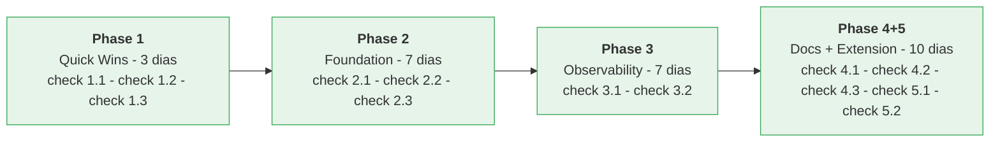

# Roteiro de Implementação — Guia Passo-a-Passo

Priorização estratégica para abordar as melhorias recomendadas na análise técnica.

**Tempo total estimado:** 3-4 semanas (dependendo do tamanho do time)

---

## FASE 1: QUICK WINS (Semana 1) — Impacto Alto, Esforço Baixo

### Sprint 1.1: Error Handling Centralizado (2-3 dias)

**Objetivo:** Substituir handlers de erro dispersos por centralizado.

**Tarefas:**

1. [ ] Criar `srv/lib/errors.ts`
   - Definir classes: `ValidationError`, `NotFoundError`, `UnauthorizedError`, `ConflictError`
   - Extendem `Error` com `code` e `details`

2. [ ] Criar `srv/middleware/error-handler.ts`
   - Implementar error-handler middleware
   - Status codes automáticos baseado em tipo de erro
   - Structured logging com correlationId

3. [ ] Integrar em `srv/server.ts`
   ```typescript
   app.use(errorHandler); // Por último!
   ```

4. [ ] Testar
   ```typescript
   // test/error-handler.test.ts
   test('ValidationError retorna 422', async () => {
       const res = await request(app).post('/odata/SalesOrders')
           .send({ salesOrder: 'invalid' });
       expect(res.status).toBe(422);
       expect(res.body.error.code).toBe('VALIDATION_FAILED');
   });
   ```

5. [ ] Refatorar handlers existentes
   - `srv/handlers/order-header-handler.ts` → throw em vez de `req.error()`
   - `srv/handlers/order-item-handler.ts` → mesma coisa
   - Remover try-catch espalhados

**Tempo:** 2-3 dias  
**ROI:** Logs consistentes, debugging mais fácil, API predictível

---

### Sprint 1.2: Structured Logging com Correlação (2-3 dias)

**Objetivo:** Rastrear requisições end-to-end.

**Tarefas:**

1. [ ] Criar `srv/middleware/request-logging.ts`
   - Gerar ou pegar `X-Correlation-ID` do header
   - Criar logger com `cds.log()` que inclui `correlationId`
   - Log de request started + finished

2. [ ] Criar `srv/middleware/context-middleware.ts`
   - Armazenar context em `req.context`
   - Incluir: `correlationId`, `userId`, `tenantId`, `timestamp`

3. [ ] Integrar em `srv/server.ts`
   ```typescript
   app.use(requestLogger);
   app.use(contextMiddleware);
   ```

4. [ ] Verificar `.cdsrc.json` tem `"log": { "format": "json" }`
   - Se não tem, adicionar para JSON logs (parseável por Cloud Logging)

5. [ ] Testar localmente
   ```bash
   npm run start 2>&1 | jq . # Pipar para jq para validar JSON
   ```

**Tempo:** 2-3 dias  
**ROI:** Debugging production issues muito mais fácil, rastreamento de erros

---

### Sprint 1.3: Rate Limiting (1-2 dias)

**Objetivo:** Proteção contra abuso.

**Tarefas:**

1. [ ] Instalar `express-rate-limit`
   ```bash
   npm install express-rate-limit
   npm install --save-dev @types/express-rate-limit
   ```

2. [ ] Criar `srv/middleware/rate-limiter.ts`
   - Memory store para dev
   - Redis store para production (se disponível)
   - Limites variáveis por role

3. [ ] Integrar em `srv/server.ts`
   ```typescript
   app.use('/odata/', apiLimiter);
   ```

4. [ ] Testar
   ```bash
   for i in {1..101}; do curl http://localhost:4004/odata/SalesOrders; done
   # Response 429: Too Many Requests
   ```

**Tempo:** 1-2 dias  
**ROI:** Protege contra DDoS simples

---

## FASE 2: FUNDAÇÃO (Semana 2) — Impacto Médio, Esforço Médio

### Sprint 2.1: Validação Fortified com Zod (3-4 dias)

**Objetivo:** Validação de schema declarativa e reutilizável.

**Tarefas:**

1. [ ] Instalar Zod
   ```bash
   npm install zod
   npm install --save-dev @types/zod
   ```

2. [ ] Criar `srv/lib/validators/sales-order-validator.ts`
   - `SalesOrderCreateSchema` com validações completas
   - `SalesOrderUpdateSchema` para updates
   - Métodos: `validateCreate()`, `validateUpdate()`, etc.

3. [ ] Criar DTO types
   ```typescript
   export type SalesOrderCreateDTO = z.infer<typeof SalesOrderCreateSchema>;
   ```

4. [ ] Integrar em handlers
   ```typescript
   srv.before('CREATE', 'SalesOrders', async (req) => {
       req.data = await validator.validateCreate(req.data);
   });
   ```

5. [ ] Testar
   ```typescript
   test('rejeita orderDate no futuro', async () => {
       const res = await request(app).post('/odata/SalesOrders')
           .send({ ..., orderDate: '2099-12-31' });
       expect(res.status).toBe(422);
   });
   ```

6. [ ] Expandir para SalesOrderItems, Partners, etc.

**Tempo:** 3-4 dias  
**ROI:** Validações type-safe, reutilizáveis, documentadas

---

### Sprint 2.2: Destination Service (Northwind) (2-3 dias)

**Objetivo:** Remover hardcode de URL, usar BTP Destination Service.

**Tarefas:**

1. [ ] Atualizar `.cdsrc.json`
   ```json
   {
     "requires": {
       "Northwind": {
         "kind": "odata-v4",
         "[development]": {
           "credentials": {
             "url": "https://services.odata.org/V4/Northwind/Northwind.svc"
           }
         },
         "[production]": {
           "credentials": {
             "destination": { "name": "Northwind" }
           }
         }
       }
     }
   }
   ```

2. [ ] Testar em dev
   ```bash
   cds watch # Deve funcionar igual
   ```

3. [ ] Criar instrutions de setup em BTP
   - Criar `docs/BTP_DESTINATION_SETUP.md`
   - Passo a passo para criar Destination "Northwind" em BTP Cockpit

4. [ ] Nenhuma mudança em handlers necessária!
   - CAP resolve automaticamente

**Tempo:** 2-3 dias  
**ROI:** Segurança (credenciais centralizadas), portabilidade

---

### Sprint 2.3: Índices em CDS (1-2 dias)

**Objetivo:** Aceleração de queries em HANA production.

**Tarefas:**

1. [ ] Analisar queries lentas
   - Usar HANA Management Console em BTP
   - Identificar campos de filtro mais comuns: `createBy`, `orderDate`, `salesOrder`

2. [ ] Adicionar `@Indexes` em `db/domain/sales-orders.cds`
   - Índice 1: `salesOrder` (PK lógico, unique)
   - Índice 2: `[orderDate, overallStatus]` (filtros comuns)
   - Índice 3: `createdBy` (auditoria)
   - Índice 4: `soldToParty_ID` (FK para join)
   - Índice 5: `deletionIndicator` (soft delete)

3. [ ] Testar regeneração de schema
   ```bash
   cds build --for hana
   ```

4. [ ] Deploy em BTP test environment
   - Validar índices criados em HANA

**Tempo:** 1-2 dias  
**ROI:** Queries 10-100x mais rápidas em escala

---

## FASE 3: OBSERVABILIDADE (Semana 2-3) — Impacto Alto, Esforço Médio-Alto

### Sprint 3.1: Métricas com Prometheus (3-4 dias)

**Objetivo:** Monitoramento de KPIs da aplicação.

**Tarefas:**

1. [ ] Instalar dependências
   ```bash
   npm install prom-client
   npm install --save-dev @types/prom-client
   ```

2. [ ] Criar `srv/observability/metrics.ts`
   - `ordersCreatedTotal` counter
   - `orderProcessingDuration` histogram
   - `apiErrors` counter
   - `queryDuration` histogram

3. [ ] Criar `srv/middleware/metrics-middleware.ts`
   - Interceptar requests
   - Registrar métricas

4. [ ] Expor endpoint `/metrics`
   ```typescript
   app.get('/metrics', (req, res) => {
       res.set('Content-Type', promClient.register.contentType);
       res.send(promClient.register.metrics());
   });
   ```

5. [ ] Integrar com SAP Cloud Logging / Prometheus
   - Se BTP: configurar scraper para `/metrics`
   - Se local: usar Prometheus + Grafana

6. [ ] Criar dashboard Grafana
   - Orders created (rate)
   - API latency p95/p99
   - Error rate by code

**Tempo:** 3-4 dias  
**ROI:** Visibilidade em tempo real, alertas proativas

---

### Sprint 3.2: OpenTelemetry Tracing (3-4 dias)

**Objetivo:** Tracing distribuído para identificar gargalos.

**Tarefas:**

1. [ ] Instalar dependências
   ```bash
   npm install @opentelemetry/sdk-node \
     @opentelemetry/auto-instrumentations-node \
     @opentelemetry/exporter-otlp-proto \
     @opentelemetry/resources \
     @opentelemetry/semantic-conventions
   ```

2. [ ] Criar `srv/observability/otel-setup.ts`
   - Inicializar SDK
   - Configurar exportador OTLP
   - Auto-instrumentação (Express, DB, HTTP)

3. [ ] Integrar em `srv/main.ts`
   ```typescript
   import { initOtel } from './observability/otel-setup';
   const shutdown = initOtel();
   ```

4. [ ] Testar com Jaeger local
   ```bash
   docker run -d \
     -e COLLECTOR_OTLP_ENABLED=true \
     -p 16686:16686 \
     -p 4318:4318 \
     jaegertracing/all-in-one
   
   export OTEL_COLLECTOR_URL=http://localhost:4318
   npm start
   ```

5. [ ] Abrir Jaeger UI: `http://localhost:16686`
   - Visualizar traces end-to-end

6. [ ] Deploy em BTP
   - Usar SAP Cloud Logging como exportador OTLP

**Tempo:** 3-4 dias  
**ROI:** Debugging de latência, otimização de performance

---

## FASE 4: QUALIDADE & DOCUMENTAÇÃO (Semana 3-4) — Impacto Médio, Esforço Médio

### Sprint 4.1: OpenAPI/Swagger (2-3 dias)

**Objetivo:** API autodocumentada, explorável.

**Tarefas:**

1. [ ] Instalar dependências
   ```bash
   npm install swagger-jsdoc swagger-ui-express
   npm install --save-dev @types/swagger-jsdoc @types/swagger-ui-express
   ```

2. [ ] Criar `srv/swagger.ts`
   - Configurar OpenAPI 3.0 spec
   - Incluir servidor, autenticação, schemas

3. [ ] Expor em `/api/docs`
   ```typescript
   app.use('/api/docs', swaggerUI.serve, swaggerUI.setup(swaggerSpec));
   ```

4. [ ] Testar localmente
   ```bash
   curl http://localhost:4004/api/docs
   ```

5. [ ] Gerar SDK client automaticamente
   - Usar `openapi-generator`
   - Deployar em npm registry

**Tempo:** 2-3 dias  
**ROI:** Onboarding de consumidores API mais rápido

---

### Sprint 4.2: CI/CD Pipeline (3-4 dias)

**Objetivo:** Integração contínua, deploy automático em BTP.

**Tarefas:**

1. [ ] Criar `.github/workflows/ci.yml`
   - Lint (ESLint)
   - Build (tsc, CDS)
   - Test (Jest)
   - SAST (SonarQube, Snyk)

2. [ ] Criar `.github/workflows/deploy-dev.yml`
   - On: push to `develop` branch
   - Build + Deploy para dev space BTP

3. [ ] Criar `.github/workflows/deploy-prod.yml`
   - On: release tag (v1.0.0)
   - Build + Deploy para prod space BTP
   - Smoke tests

4. [ ] Configurar GitHub Secrets
   - `BTP_USERNAME`, `BTP_PASSWORD`, `BTP_ORG`, `BTP_SPACE`

5. [ ] Testar pipeline
   - Fazer push para develop
   - Observar GitHub Actions execução
   - Validar deploy em BTP

**Tempo:** 3-4 dias  
**ROI:** Deploy confiável, menos erros manuais

---

### Sprint 4.3: Documentação & AWS ALB (2-3 dias)

**Objetivo:** Referência técnica e deployment.

**Tarefas:**

1. [ ] Atualizar `ARCHITECTURE.md`
   - Adicionar diagrama arquitetônico
   - Explicar transaction semantics
   - Exemplo de extensão

2. [ ] Criar `docs/API_REFERENCE.md`
   - Endpoints principais
   - Exemplos de requisição/resposta
   - Tratamento de erros

3. [ ] Criar `docs/DEPLOYMENT_BTP.md`
   - Pré-requisitos
   - Build & deploy com MTA
   - Configuração de variáveis de ambiente

4. [ ] Criar `docs/MONITORING.md`
   - Métricas Prometheus
   - Logs estruturados
   - Alertas

5. [ ] Criar `docs/DEVELOPMENT.md`
   - Setup local
   - Rodando testes
   - Debug com VS Code

**Tempo:** 2-3 dias  
**ROI:** Time consegue se onboard + produtivo

---

## FASE 5: EXTENSIBILIDADE (Semana 4) — Impacto Alto, Esforço Alto

### Sprint 5.1: Extensibility Service (SaaS) (4-5 dias)

**Objetivo:** Sistema de extensões para customização por tenant.

**Tarefas:**

1. [ ] Ativar em `.cdsrc.json`
   ```json
   {
     "requires": {
       "cds.xt.SaasProvisioningService": {
         "[production]": { "kind": "saas-provisioning" }
       },
       "cds.xt.ExtensibilityService": {
         "[production]": true
       }
     }
   }
   ```

2. [ ] Criar sidecar multitenancy
   - Já existe em `srv/mtx/sidecar.ts`
   - Ativar endpoints de provisionamento

3. [ ] Documentar extensibility
   - Custom fields
   - Custom handlers
   - Custom apps

4. [ ] Testar em BTP
   - Provisionar novo tenant
   - Adicionar custom field
   - Validar isolamento de dados

**Tempo:** 4-5 dias  
**ROI:** Suporte a multi-tenant SaaS

---

### Sprint 5.2: Integração com Workflow (3-4 dias)

**Objetivo:** Aprovações de pedidos via SAP Workflow.

**Tarefas:**

1. [ ] Criar `srv/integration/workflow-client.ts`
   - Conexão com SAP Workflow API
   - Método: `startApprovalWorkflow(order)`

2. [ ] Atualizar handler submitOrder
   ```typescript
   srv.on('submitOrder', 'SalesOrders', async (req) => {
       // ... validações ...
       
       // Iniciar workflow (em BTP)
       if (process.env.NODE_ENV === 'production') {
           await workflowClient.startApprovalWorkflow(order);
       }
       
       // Status local: Pending Approval
       await UPDATE('SalesOrders').set({ overallStatus: 'A' });
   });
   ```

3. [ ] Criar workflow em SAP Workflow Modeler
   - Pedir aprovação a SalesManager
   - Onsubmit/onreject: callback para CAP

4. [ ] Implementar webhook callback
   ```typescript
   app.post('/webhooks/workflow', async (req) => {
       const { orderId, status } = req.body;
       if (status === 'APPROVED') {
           await UPDATE('SalesOrders').set({ overallStatus: 'B' });
       }
   });
   ```

**Tempo:** 3-4 dias  
**ROI:** Integração com SAP Workflow completa

---

## Timeline Consolidada



**Total: ~27 dias (3-4 semanas) com 1 developer FTE**

---

## Checklist por Sprint

### Checklist Phase 1 (Semana 1)

- [ ] Sprint 1.1: Error handler rodando localmente
- [ ] Sprint 1.2: Logs com correlationId visíveis em console
- [ ] Sprint 1.3: Rate limit testado (429 response)
- [ ] Commits com histórico claro
- [ ] Code review aprovado

### Checklist Phase 2 (Semana 2)

- [ ] Sprint 2.1: Validações com Zod cobrindo 100% das entidades
- [ ] Sprint 2.2: Northwind rodando via Destination Service
- [ ] Sprint 2.3: Índices criados em HANA dev (validar via plano de query)
- [ ] Testes passando (Jest)

### Checklist Phase 3 (Semana 2-3)

- [ ] Sprint 3.1: Métricas expostas em `/metrics`, Prometheus/Grafana consumindo
- [ ] Sprint 3.2: Traces visíveis em Jaeger
- [ ] Alertas configurados (ex: error rate > 1%)

### Checklist Phase 4 (Semana 3-4)

- [ ] Sprint 4.1: Swagger em `/api/docs`, exploração funcional
- [ ] Sprint 4.2: GitHub Actions pipeline rodando, deploy automático funcionando
- [ ] Sprint 4.3: Documentação atualizada + completa

### Checklist Phase 5 (Semana 4)

- [ ] Sprint 5.1: Multitenancy habilitada em BTP, novo tenant testado
- [ ] Sprint 5.2: Workflow integrado, aprovação end-to-end funcionando

---

## Dependências & Bloqueadores

| # | Bloqueador | Solução | MVP |
|---|-----------|---------|-----|
| 1 | Acesso BTP para deploy | Solicitar ao admin | Usar dev local até Semana 3 |
| 2 | Red is para cache (Phase 2) | Usar MemoryStore dev | Implementar Redis apenas prod |
| 3 | SAP Workflow license | Validar no BTP tenant | Pular Sprint 5.2 se não tem |
| 4 | HANA credentials | Pedir ao DBA | Usar SQLite dev, validar índices em BTP |

---

## Sucesso & Métricas

**KPIs de sucesso após implementação:**

- ✅ **Observability:** 100% de requests com correlationId
- ✅ **Errors:** 0 unhandled errors (todos centralizado)
- ✅ **Performance:** p95 latência < 500ms (com índices)
- ✅ **Testability:** Coverage > 80%
- ✅ **DevOps:** Deploy BTP < 5 min (CI/CD automático)
- ✅ **Documentation:** API self-documented (Swagger 100%)
- ✅ **Scalability:** Suporta 10x crescimento de users (com multitenancy)

---

**Próximas ações:**
1. Escolher gerente de projeto/tech lead
2. Alocar 1 FTE para 4 semanas
3. Criar GitHub issues por sprint
4. Setup de sprints semanais + demos
5. Começar Sprint 1.1 segunda-feira

Good luck! 🚀
